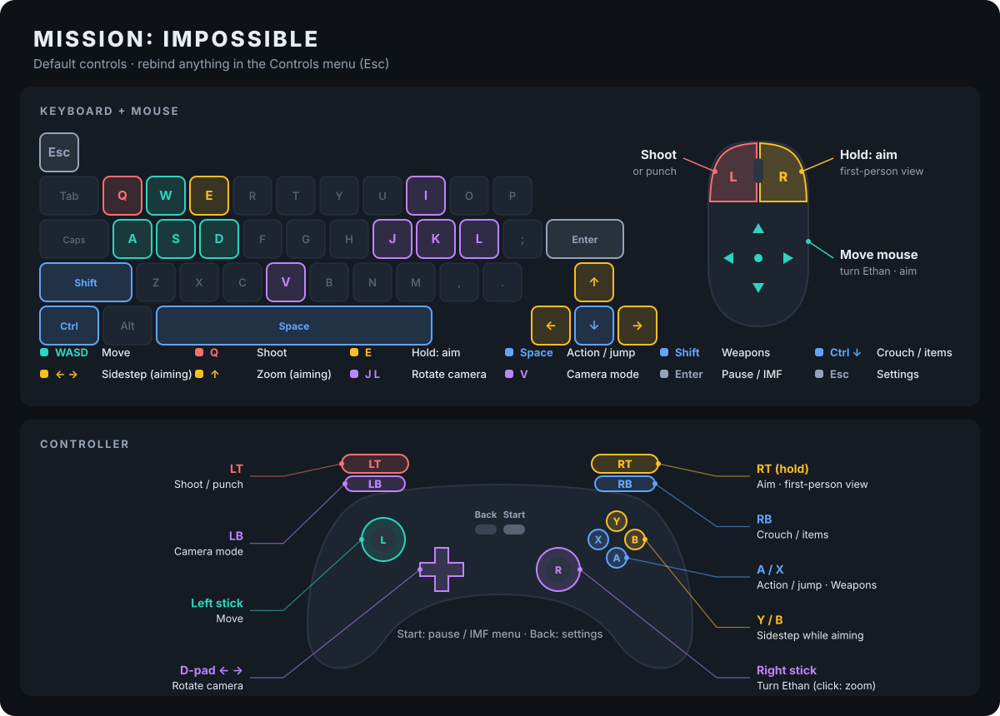

<div align="center">

# Mission: Impossible — PC Recomp

**The 1998 N64 classic, running natively on PC.**
60 FPS · widescreen at any resolution · keyboard & mouse · analog camera

[Controls](#controls) · [Settings](#settings) · [Build](#building) · [Roadmap](docs/ROADMAP.md) · [How it works](#how-it-works)

</div>

---

This is a static recompilation of *Mission: Impossible* (N64, USA) made with
[N64Recomp](https://github.com/N64Recomp/N64Recomp). The game's MIPS code is translated to C, compiled for your PC
and run on [N64ModernRuntime](https://github.com/N64Recomp/N64ModernRuntime), with
[RT64](https://github.com/rt64/rt64) for rendering. It is not an emulator: the game runs as a native program.
The app is built like [BanjoRecomp](https://github.com/BanjoRecomp/BanjoRecomp), on
[RecompFrontend](https://github.com/N64Recomp/RecompFrontend).

> **You need your own ROM.** No game data is in this repository. Use a dump of *Mission Impossible (USA)*,
> sha1 `7546d5df1fc93fed8205a066f1333fd7dd50c1e1`.

## Features

| | |
|---|---|
| 🎯 **Keyboard & mouse** | WASD to move and the mouse to turn Ethan. Hold right mouse to aim with the mouse, left click to shoot. Works in the sniper scope and the gunboat turret too. |
| 🕹️ **Analog camera** | The right stick turns Ethan and the camera, like a modern third-person game. |
| ⚡ **60 FPS** | The game's logic runs on the video clock, so the game runs at the same speed as on an N64, just smoother. |
| 🖥️ **High resolution & widescreen** | Renders at your window's resolution with MSAA, widescreen expansion and a HUD that stays in place. |
| 🐧 **Native Linux** | Native Wayland, starts in under a second, keeps running when the window is hidden. |
| 🎮 **All 20 levels** | Every level loads and plays at 60 FPS. |

## Controls



Rebind anything in the **Controls** tab of the settings menu (**Esc** on the keyboard, **Back** on a controller).

<details>
<summary>Controls as a table</summary>

| Action | Keyboard & mouse | Controller |
|---|---|---|
| Move | W A S D | Left stick |
| Turn Ethan / camera | Mouse | Right stick |
| Aim, first-person view (hold) | Right mouse, E | Right trigger |
| Shoot / punch | Left mouse, Q | Left trigger |
| Action / jump | Space | A |
| Cycle weapons | Left Shift | X |
| Crouch, item inventory | Left Ctrl, ↓ | Right bumper |
| Sidestep while aiming | ← / → | Y / B |
| Zoom while aiming | ↑ | Right stick click |
| Camera mode | V | Left bumper |
| Rotate camera | J / L | D-pad ← / → |
| Pause / IMF menu | Enter | Start |
| Settings | Esc | Back |

</details>

## Settings

- **Graphics > Frame Rate**: 60 FPS (default) or Original (30). Resolution, MSAA and aspect ratio are on the
  same tab.
- **General > Mouse Sensitivity**: 50% by default. Set it to 0 to turn mouse turning off and free the cursor.
- **General > Analog Camera / Analog Camera Speed**: turning with the right stick.

## Building

Linux, with clang. The ROM goes in `rom/`, which git ignores.

```sh
git clone --recurse-submodules https://github.com/nickallevato/mi_n64_exe.git && cd mi_n64_exe
mkdir -p rom && cp "<path>/Mission Impossible (USA).z64" rom/
sudo apt-get install cmake ninja-build clang lld libsdl2-dev libgtk-3-dev libfreetype-dev
```

**1. Disassemble and recompile the game.** This uses tools that stay outside the repo (`tools/` is ignored):

```sh
git clone https://github.com/shygoo/n64sym.git tools/n64sym && make -C tools/n64sym
python3 -m venv tools/venv && tools/venv/bin/pip install 'splat64[mips]'

cd split && ln -sf "../rom/Mission Impossible (USA).z64" baserom.z64 \
  && ../tools/venv/bin/python -m splat split missionimpossible.yaml && cd ..

cmake -S lib/N64ModernRuntime/N64Recomp -B build/n64recomp -G Ninja -DCMAKE_BUILD_TYPE=Release
cmake --build build/n64recomp --target N64Recomp RSPRecomp
scripts/recomp.sh        # game code -> RecompiledFuncs/, audio microcode -> rsp/
```

**2. Build and run the app:**

```sh
cmake -S . -B build/app -G Ninja -DCMAKE_BUILD_TYPE=Release -DCMAKE_C_COMPILER=clang -DCMAKE_CXX_COMPILER=clang++
cmake --build build/app
build/app/MIRecompiled                                             # pick the ROM in the launcher, or
MI_ROM="rom/Mission Impossible (USA).z64" build/app/MIRecompiled   # boot straight into the game
```

## Status

All 20 levels load and play; full playthroughs haven't been verified yet. Known issues:
- Music: only the start of the first track plays (being investigated).
- The app can crash while quitting. Your save isn't affected.

See [docs/ROADMAP.md](docs/ROADMAP.md) for what's done and what's next: full playthroughs, Rumble Pak,
packaging, mod support and texture packs.

## How it works

<details>
<summary>ROM layout</summary>

There's no decomp of this game, so the function list comes from a [splat](https://github.com/ethteck/splat)
disassembly instead of an ELF.

| What | ROM | VRAM |
|---|---|---|
| entrypoint | `0x1000` | `0x80000400` |
| `.text` (CPU code, 1697 funcs) | `0x1000`–`0x84A60` | `0x80000400`– |
| rspboot microcode | `0x84A60`–`0x84C90` | |
| data / rodata | `0x84C90`–`0x94440` | |
| bss (`0x27A00`) | — | `0x80093840` |
| assets (no Yay0/Yaz0/MIO0, no plain code found) | `0x94440`–`0xC00000` | |

`game_main` is at `0x8000E090`. Graphics use F3DEX.NoN 1.21 (RT64 HLE); audio is `n_aspMain`, recompiled with
RSPRecomp.

</details>

<details>
<summary>Runtime fixes</summary>

- **Busy-wait loops** (`[[patches.hook]]` in `mi.us.toml`): the game spins on globals that interrupt-driven
  threads update. ultramodern schedules game threads cooperatively, so those loops get a yield hook.
- **libultra functions n64sym missed** are named in `symbols/manual.txt` so the runtime replaces them (AI, SI,
  EEPROM long read, ...). An unreplaced libultra function that waits on hardware hangs or crashes.
- **Wayland**: on a Wayland session the app uses native Wayland. Through XWayland, NVIDIA's Vulkan presentation
  stalls (the game runs at ~0-2 fps).
- **Hidden windows**: FIFO presentation blocks while the window is hidden (NVIDIA + Wayland), freezing the game.
  `patches/deps/plume-prefer-mailbox.patch` (applied to RT64's plume by CMake) uses mailbox presentation when
  available; a hidden window keeps running at 60 FPS with normal CPU/GPU use.
- **Startup**: SDL audio is initialized before the file-dialog library, and the dialog uses the XDG portal
  instead of in-process GTK; either ordering issue or GTK init could stall startup for 25+ s.

</details>

<details>
<summary>Symbols</summary>

- `symbols/libultra.txt`: libultra functions found by `n64sym -s`. n64sym reports jal-discovered addresses with
  a `0x7` prefix for this ROM (bug: base `0x7FFFF400 & 0xF0000000`); these were corrected to `0x8`. Internal
  `*_text_XXXX` labels and false positives were removed.
- `symbols/manual.txt`: hand-identified names; overrides `libultra.txt`.

Correct libultra names matter: N64Recomp skips or replaces functions by name (`src/symbol_lists.cpp`) so that
N64ModernRuntime can provide its own implementations.

</details>

<details>
<summary>Dev tools</summary>

- `scripts/capture.sh` runs the game in a headless sway compositor (real GPU, invisible), takes screenshots with
  grim and injects controller input through `MI_INPUT`.
- `scripts/level_test.sh` unlocks every level, navigates to one and plays it with random input.
- `scripts/stacks.py` prints the recompiled game threads' call stacks (gdb).
- `scripts/find_spins.py` lists busy-wait loops that need yield hooks.
- `scripts/gen_controls_map.py docs/controls.svg` redraws the controls map.
- `MI_STATS=1` prints graphics tasks and VIs per second; `MI_WATCH=addr[:n],...` prints game RAM each second.

</details>

## Yes, AI wrote this

This port was made with AI: Claude did the reverse engineering, the runtime fixes, the controls and this README,
and a human pointed it at the game and played it. It's in the commit history, and we're not going to apologize for
it. Before this project, *Mission: Impossible* had no decomp, no recomp and no PC port. Something that runs at
60 FPS with mouse aiming beats nothing.

**Thank you** to the people who built the foundation by hand, over years, so a project like this could happen
in days:
- **Mr-Wiseguy**, for [N64Recomp](https://github.com/N64Recomp/N64Recomp),
  [N64ModernRuntime](https://github.com/N64Recomp/N64ModernRuntime) and
  [Zelda64Recomp](https://github.com/Zelda64Recomp/Zelda64Recomp). They proved static recompilation of N64 games
  works and set the bar for what a PC port should feel like.
- **Dario**, for [RT64](https://github.com/rt64/rt64), which is why this looks good at any resolution.
- The [RecompFrontend](https://github.com/N64Recomp/RecompFrontend) and
  [BanjoRecomp](https://github.com/BanjoRecomp/BanjoRecomp) contributors, for the launcher, menus and input layer
  this app is built on.
- **ethteck** and contributors for [splat](https://github.com/ethteck/splat), and **shygoo** for
  [n64sym](https://github.com/shygoo/n64sym).
- Everyone in the N64 decomp scene who mapped out libultra, the microcodes and the hardware by hand. Every
  function name the tools recognized here traces back to your work.

You did the hard, original part. The grunt work of applying it game by game (naming thousands of functions, chasing
busy-wait loops, wiring up mouse aim) is something we can now do on our own subscription and our own inference,
so you don't have to. You're welcome to it: fork it, borrow from it, or ignore it.

*Mission: Impossible* is © its respective owners. This project contains no game assets.
